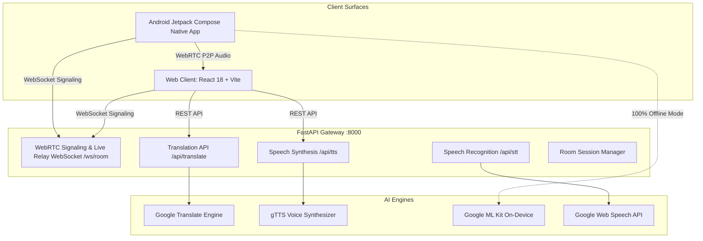
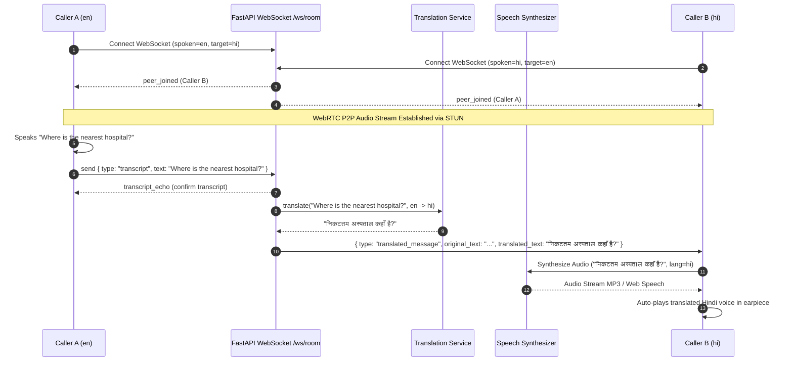

# LinguaLive AI — Architecture & Engineering Specification

## 1. System Overview

**LinguaLive AI** is a real-time, bidirectional voice translation and offline text translation platform designed for:
1. **Phone-to-Phone WebRTC Voice Calls**: Remote peer-to-peer audio calls with real-time speech transcription and automated translated voice synthesis relayed to the peer.
2. **Face-to-Face Dual Conversation**: Split-screen in-person mode with an inverted top display (180° rotation) for conversation partners sitting across a table.
3. **Instant Speech & Text Translation**: Multilingual workspace supporting English, Hindi, Punjabi, Spanish, French, German, Japanese, and 10+ regional Indian and global languages.
4. **Camera Vision OCR**: Real-time sign, document, and menu text recognition and translation.
5. **Offline Google ML Kit**: 100% on-device neural translation without cellular or Wi-Fi connectivity.



---

## 2. WebRTC Real-Time Voice Translation Flow

When Caller A (speaking English) and Caller B (listening in Hindi) enter a room:



---

## 3. Supported Languages & Offline Matrix

| Language | Code | Online STT | Online TTS | Offline ML Kit | On-Device Model Size |
|---|---|:---:|:---:|:---:|:---:|
| **English** | `en` | ✅ | ✅ | ✅ | ~30 MB |
| **Hindi** | `hi` | ✅ | ✅ | ✅ | ~32 MB |
| **Punjabi** | `pa` | ✅ | ✅ | Cloud Pair | Online Engine |
| **Spanish** | `es` | ✅ | ✅ | ✅ | ~28 MB |
| **French** | `fr` | ✅ | ✅ | ✅ | ~29 MB |
| **German** | `de` | ✅ | ✅ | ✅ | ~31 MB |
| **Japanese** | `ja` | ✅ | ✅ | ✅ | ~34 MB |
| **Chinese (Simplified)** | `zh-cn` | ✅ | ✅ | ✅ | ~35 MB |
| **Arabic** | `ar` | ✅ | ✅ | ✅ | ~31 MB |
| **Russian** | `ru` | ✅ | ✅ | ✅ | ~32 MB |
| **Bengali** | `bn` | ✅ | ✅ | ✅ | ~33 MB |
| **Tamil** | `ta` | ✅ | ✅ | ✅ | ~33 MB |
| **Telugu** | `te` | ✅ | ✅ | ✅ | ~32 MB |
| **Marathi** | `mr` | ✅ | ✅ | ✅ | ~31 MB |
| **Gujarati** | `gu` | ✅ | ✅ | ✅ | ~32 MB |
| **Urdu** | `ur` | ✅ | ✅ | ✅ | ~30 MB |

---

## 4. Development & Deployment

### Backend
```bash
cd backend
python -m uvicorn app.main:app --host 0.0.0.0 --port 8000 --reload
```

### Web Application
```bash
cd web
npm run dev
```

### Automated Tests
```bash
python -m pytest tests/test_backend.py
```
